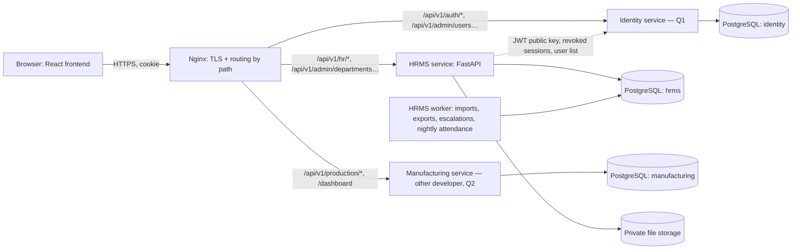

# HRMS Microservice: Analysis and Architecture (Phases 1–2)

**Status:** analysis approved with the decisions below (3 November 2026). Implementation follows
section 11.

## Decisions

| # | Decision | Effect on HRMS |
|---|---|---|
| Q1 | **The other developer owns sign-in**, users, roles and permissions, and the shared platform features (notifications, company settings, integrations, the audit screen, the administration overview) | HRMS contains **no** login, password or user tables. It validates the token issued by the other developer's service through a configurable verifier, following [`AUTH_INTEGRATION.md`](./AUTH_INTEGRATION.md). HRMS keeps its **own** audit log of HR actions and exposes it to the platform through an API |
| Q2 | `/dashboard/summary` and `/production/*` belong to the other developer's service | Out of HRMS scope |
| Q3 | Payroll components use **formula types**; statutory rates and slabs are **entered by HR** | No rates are pre-filled. Payroll validation blocks calculation until every component it needs is fully configured |
| Q4 | Reference lists are loaded from a **setup file** and can also be changed through **admin API endpoints** | `app/scripts/load_reference_data.py` + YAML files in `setup/`, plus CRUD endpoints under `/api/v1/hr/setup/*` (new, backend-only for now; documented in `API_MAPPING.md`) |

HRMS therefore implements the **144 HRMS endpoints** in `API_MAPPING.md`, plus the setup endpoints
and the attendance ingestion endpoint. The 34 endpoints marked Identity, Platform or Manufacturing
are the other developer's.

**Sources analysed**

| Source | What it gave |
|---|---|
| Frontend `src/features/**/api/*.service.ts` (17 files, 2,843 lines) | Exact request and response shapes for every endpoint |
| Frontend `src/features/**/api/*.http.ts` | Exact methods, paths and query parameters: **178 endpoints** |
| Frontend sample-data services (`src/mocks/**`, 7,000 lines, from the backup copy) | Reference behaviour: validation, state transitions, scoping, calculations |
| `BACKEND_GUIDE.md`, `HRMS_API_CONTRACTS.md` (Parts A–H), `API_CONTRACTS.md`, `HRMS_SECURITY.md` | Conventions, permissions, business rules, open questions |
| Frontend `src/features/hr/permissions.ts`, `src/features/admin/permissions.ts` | Permission catalogue (75 codes: 56 HR, 19 administration) and default role templates |
| Frontend `src/api/client.ts`, `tokenStore.ts`, `AuthContext.tsx` | How sign-in, cookies, tokens and session expiry actually work |

The full endpoint table, with the owner, controller and permission for every endpoint, is in
[`API_MAPPING.md`](./API_MAPPING.md).

---

## 1. HRMS business concepts

Each concept below gets its own model, schema, repository, service and controller (section 5).

| Area | Business concepts | Endpoints |
|---|---|---|
| **Organization & reference data** | Department, Designation, Reporting line, Employment type, Employee status (with allowed transitions), Work location, Document type and category, Payroll field definition | 21 |
| **Employee management** | Employee, Employee status change, Employee history, Employee lookup | 7 |
| **Employee documents** | Employee document (upload, download, verification), Document checklist, Document compliance | 7 |
| **Employee import** | Import field catalogue, Row validation, Import job | 4 |
| **HR workspace** | Workforce summary, HR tasks (derived), Activity feed, Upcoming events | 4 |
| **Attendance** | Attendance day (calculated), Attendance summary, Monthly attendance, Attendance calendar, Attendance event (device and mobile), Attendance correction, Shift, Shift assignment, Attendance device, Device sync run | 19 |
| **Leave & requests** | Leave type, Leave policy, Holiday, Leave request, Leave estimate, Leave balance (ledger), Leave approval workflow and escalation, Permission request, Overtime request, Approval inbox | 26 |
| **Payroll** | Payroll period (state machine), Payroll validation, Payroll inputs, Payroll calculation and results, Salary component, Salary structure, Employee salary, Payroll configuration, Configuration assignment and effective-configuration resolution, Payslip, Payroll register report | 30 |
| **Performance** | Appraisal cycle, Rating scale, Competency, Goal and progress, Performance review and manager assessment, Development plan and actions | 15 |
| **HR administration** | Approval workflow (generic: corrections, overtime, payroll, reviews), HR policy (6 areas), Workflow process catalogue | 9 |
| **Reports** | Report catalogue (definitions in code), Report execution, CSV export, Report dashboard, Export activity | 5 |
| **Cross-cutting** | Audit log, Background job, File storage, Notifications (see Q1) | — |

Outside HRMS (see Q1 and Q2): sign-in and sessions, users, roles and permissions, company
settings, integrations, the administration overview, and the production dashboard and work orders.

---

## 2. API endpoints

All 178 endpoints are listed in [`API_MAPPING.md`](./API_MAPPING.md). Summary:

| Proposed owner | Count | Prefixes |
|---|---|---|
| **HRMS** | 144 | `/hr/*`, `/admin/departments`, `/admin/designations`, `/admin/reporting-lines`, `/admin/workflows*`, `/admin/workflow-processes`, `/admin/policies/*` |
| Identity (Q1) | 16 | `/auth/*`, `/admin/users*`, `/admin/roles*`, `/admin/permissions` |
| Platform (Q1) | 13 | `/notifications*`, `/admin/settings/company`, `/admin/integrations*`, `/admin/audit-events`, `/admin/overview` |
| Manufacturing (Q2) | 5 | `/dashboard/summary`, `/production/*` |

**Two endpoints the frontend needs but does not call yet** (needed for data to exist):

| Endpoint | Why |
|---|---|
| `POST /hr/attendance/events/ingest` (device API key) | Fingerprint devices and the mobile app must deliver check-in events somewhere. The frontend only reads events. The device vendor and protocol are open (Q5) |
| `POST /auth/change-password` | Forced first-sign-in password change (contract question G-Q5). Needs one small frontend screen later |

**Conventions the service will follow exactly** (from `HRMS_API_CONTRACTS.md` Part A): base
`/api/v1`; camelCase JSON via Pydantic `alias_generator=to_camel`; ISO dates and UTC date-times;
durations in integer minutes; money as decimal strings; `{ items, meta }` pagination with
`page`, `pageSize` ∈ {10, 25, 50, 100}, `sort=field:dir` (unknown field → 400); `version` with
409 `STALE_VERSION`; workflow actions as `POST …/{action}` with 409 `INVALID_TRANSITION`; the
error envelope `{ error: { code, message, details[] } }`; `X-Request-Id` on every response.

**Contract mismatches found** (the frontend is the reference; documented, not changed):

| Item | Frontend sends or expects | Contract says | Plan |
|---|---|---|---|
| Money in payroll responses | `number` (`gross`, `net`, `amount`) | Decimal string + currency | Follow the frontend: JSON numbers serialised from `Decimal` with 2 places. Arithmetic stays in `Decimal`. Changing to strings needs a frontend change (Q9) |
| Job status | `queued`, `running`, `succeeded`, `failed`, `cancelled` | Your brief shows `processing` | Follow the frontend |
| Leave submission | `multipart/form-data` (attachments) | JSON | Follow the frontend |

---

## 3. PostgreSQL entities

One database, **`hrms`**, owned only by the HRMS service. Every business table has
`id` (UUID, returned as an opaque string), `created_at`, `created_by`, `updated_at`, `updated_by`,
and `version` where the record is editable. No foreign keys to other services' data: user IDs
are stored as plain UUID columns.

| Area | Tables | Key constraints |
|---|---|---|
| Reference | `department` (self-ref `parent_id`, `head_employee_id`), `designation`, `designation_department`, `employment_type`, `employee_status`, `employee_status_transition`, `work_location`, `document_category`, `document_type`, `payroll_field_definition` | Unique `code` per table; transitions unique (from, to) |
| Employee | `employee`, `employee_payroll_value` (encrypted), `employee_status_change`, `employee_history`, `reporting_line_change` | Unique `employee_code`; unique `attendance_id`; unique lower(email) where not null; self-FK `reporting_manager_id`; check `joining_date ≤ probation_end_date` |
| Documents | `employee_document`, `document_verification_event` | FK employee, document type; `storage_key` unique; size > 0 |
| Jobs | `background_job` | status check; index (status, run_after) |
| Attendance | `shift`, `shift_department`, `shift_assignment`, `attendance_policy_option`, `overtime_policy_option`, `attendance_device`, `device_sync_run`, `attendance_event`, `attendance_day`, `attendance_correction` | Unique (employee, date) on `attendance_day`; index (employee, attendance_date) on events; unique `device_event_reference` per device |
| Leave | `leave_type`, `leave_policy`, `holiday`, `leave_ledger_entry`, `leave_request`, `leave_request_attachment`, `leave_approval_workflow`, `leave_workflow_department`, `leave_approval_event`, `permission_request`, `overtime_request`, `request_event` | `from ≤ to`; unique holiday date; partial index on pending requests |
| Payroll | `salary_component`, `salary_structure`, `salary_structure_component`, `employee_salary`, `employee_category`, `payroll_rule_option`, `payroll_configuration`, `payroll_configuration_component`, `payroll_configuration_assignment`, `payroll_period`, `payroll_validation_run`, `payroll_input`, `payroll_result`, `payroll_result_line`, `payslip` | Unique period `month`; unique (period, employee) on results; `numeric(14,2)` money; check scope matches department/employee |
| Performance | `rating_scale`, `rating_level`, `competency`, `appraisal_cycle`, `cycle_competency`, `cycle_recommendation_option`, `goal`, `goal_progress_update`, `performance_review`, `review_assessment`, `review_competency_rating`, `development_plan`, `development_action` | Unique (cycle, employee) on reviews; progress 0–100 |
| HR administration | `approval_workflow`, `approval_workflow_step`, `approval_workflow_history`, `hr_policy_document`, `hr_policy_history` | One published workflow per process at a time; one policy row per area |
| Reports | `report_activity` | — |
| Platform | `audit_log` (append-only), `notification`, `notification_preference` (Q1) | `audit_log` has no `updated_*` columns and refuses UPDATE/DELETE (section 8) |

About **77 tables**. The entity-relationship diagram is in [`ER_DIAGRAM.md`](./ER_DIAGRAM.md).

**`attendance_day` is calculated, not entered.** The attendance service rebuilds a day whenever
its inputs change (an event arrives, a correction is approved, leave is approved, a shift or
holiday changes), and a nightly job finalises past days.

---

## 4. Folder structure

The structure you specified, with one file per business concept in each layer:

```text
hrms-service/
├── alembic/                 env.py (async), script.py.mako, versions/
├── app/
│   ├── api/
│   │   ├── controllers/     employee_controller.py, leave_request_controller.py, … (≈45)
│   │   └── router.py        mounts every controller under /api/v1
│   ├── core/                config.py (pydantic-settings), security.py (JWT verify), permissions.py
│   │                        (catalogue + require()), errors.py, logging.py, context.py (request/user)
│   ├── database/            base.py (Base + AuditMixin + VersionMixin), session.py (async engine),
│   │                        audit_listener.py (fills created_by/updated_by)
│   ├── middleware/          request_id.py, access_log.py, csrf_origin.py, rate_limit.py
│   ├── models/              employee_model.py, department_model.py, leave_request_model.py, …
│   ├── repositories/        base_repository.py (paging/sorting helpers only), employee_repository.py, …
│   ├── schemas/             common.py (CamelModel, Page[T], ErrorEnvelope), employee_schema.py, …
│   ├── scripts/             worker.py (background jobs), create_admin.py, load_reference_data.py
│   ├── services/            employee_service.py, attendance_calculator.py, leave_balance_service.py, …
│   ├── utils/               dates.py, money.py, csv_export.py, file_types.py
│   └── main.py              app factory, lifespan, exception handlers
├── storage/                 local private files (git-ignored contents)
├── tests/                   unit/, repositories/, services/, api/ + conftest.py (test database)
├── deploy/                  nginx.conf, docker-compose.yml, backup.sh
├── docs/                    this analysis, API mapping, ER diagram, deployment, integration guide
├── .env.example  .gitignore  .dockerignore  alembic.ini  Dockerfile  requirements.txt  README.md
```

`.env`, `venv/` and the contents of `storage/` are git-ignored.

---

## 5. Repository-Service-Controller organisation

| Concept | Model | Repository | Service | Controller |
|---|---|---|---|---|
| Employee | `employee_model` | `employee_repository` | `employee_service` | `employee_controller` |
| Employee status change | `employee_status_change_model` | `employee_status_change_repository` | `employee_status_service` | (in `employee_controller`: `POST …/status-changes`) |
| Employee history | `employee_history_model` | `employee_history_repository` | `employee_history_service` | (`GET …/history`) |
| Employee document | `employee_document_model` | `employee_document_repository` | `employee_document_service` | `employee_document_controller` |
| Document compliance | — (reads documents) | `document_compliance_repository` | `document_compliance_service` | (in `employee_document_controller`) |
| Employee import | `background_job_model` | `background_job_repository` | `employee_import_service` | `employee_import_controller` |
| Department | `department_model` | `department_repository` | `department_service` | `department_controller` |
| Designation | `designation_model` | `designation_repository` | `designation_service` | `designation_controller` |
| Reporting line | `reporting_line_change_model` | `reporting_line_repository` | `reporting_line_service` | `reporting_line_controller` |
| Reference data | one model per list | `reference_data_repository` | `reference_data_service` | `reference_data_controller` |
| Attendance day | `attendance_day_model` | `attendance_day_repository` | `attendance_service` + `attendance_calculator` | `attendance_controller` |
| Attendance event | `attendance_event_model` | `attendance_event_repository` | `attendance_event_service` | `attendance_event_controller` |
| Attendance correction | `attendance_correction_model` | `attendance_correction_repository` | `attendance_correction_service` | `attendance_correction_controller` |
| Shift | `shift_model` | `shift_repository` | `shift_service` | `shift_controller` |
| Attendance device | `attendance_device_model` | `attendance_device_repository` | `attendance_device_service` | `attendance_device_controller` |
| Leave request | `leave_request_model` | `leave_request_repository` | `leave_request_service` | `leave_request_controller` |
| Leave balance | `leave_ledger_model` | `leave_balance_repository` | `leave_balance_service` | `leave_balance_controller` |
| Leave policy / type | `leave_policy_model` | `leave_policy_repository` | `leave_policy_service` | `leave_policy_controller` |
| Holiday | `holiday_model` | `holiday_repository` | `holiday_service` | `holiday_controller` |
| Leave approval workflow | `leave_workflow_model` | `leave_workflow_repository` | `leave_workflow_service` + `leave_escalation_service` | `leave_workflow_controller` |
| Permission request | `permission_request_model` | `permission_request_repository` | `permission_request_service` | `permission_request_controller` |
| Overtime request | `overtime_request_model` | `overtime_request_repository` | `overtime_request_service` | `overtime_request_controller` |
| Approval inbox | — (reads the four request types) | `approval_inbox_repository` | `approval_inbox_service` | `approval_inbox_controller` |
| Payroll period | `payroll_period_model` | `payroll_period_repository` | `payroll_period_service` + `payroll_calculator` | `payroll_period_controller` |
| Salary component / structure | `salary_component_model`, `salary_structure_model` | `salary_structure_repository` | `salary_structure_service` | `salary_structure_controller` |
| Employee salary | `employee_salary_model` | `employee_salary_repository` | `employee_salary_service` | `employee_salary_controller` |
| Payroll configuration | `payroll_configuration_model` | `payroll_configuration_repository` | `payroll_configuration_service` | `payroll_configuration_controller` |
| Configuration assignment | `payroll_assignment_model` | `payroll_assignment_repository` | `payroll_assignment_service` + `effective_configuration_resolver` | (in `payroll_configuration_controller`) |
| Payslip | `payslip_model` | `payslip_repository` | `payslip_service` | `payslip_controller` |
| Payroll report | — | `payroll_report_repository` | `payroll_report_service` | `payroll_report_controller` |
| Appraisal cycle | `appraisal_cycle_model` | `appraisal_cycle_repository` | `performance_cycle_service` | `performance_cycle_controller` |
| Goal | `goal_model` | `goal_repository` | `goal_service` | `goal_controller` |
| Performance review | `performance_review_model` | `performance_review_repository` | `performance_review_service` | `performance_review_controller` |
| Development plan | `development_plan_model` | `development_plan_repository` | `development_plan_service` | `development_plan_controller` |
| Approval workflow | `approval_workflow_model` | `approval_workflow_repository` | `approval_workflow_service` | `approval_workflow_controller` |
| HR policy | `hr_policy_model` | `hr_policy_repository` | `hr_policy_service` | `hr_policy_controller` |
| HR workspace | — | `hr_workspace_repository` | `hr_workspace_service` | `hr_workspace_controller` |
| Report | `report_activity_model` | `report_repository` | `report_service` (one runner per report) | `report_controller` |
| Audit log | `audit_log_model` | `audit_log_repository` | `audit_service` | (Platform, Q1) |

**Rules for each layer**
- **Controllers:** parse and validate the request (Pydantic), apply `Depends(require("…"))`, call one
  service method, return a response schema. No queries, no business rules.
- **Services:** business rules, state transitions, record and field scoping, transactions
  (`async with session.begin()`), audit entries, calls to other services.
- **Repositories:** SQLAlchemy queries only: get, list with filters, sort and paging, add, update.
  `base_repository.py` holds shared paging and sorting helpers. It is not a generic repository.
- **Dependency injection:** FastAPI `Depends` provides the session, the current user, and each
  service with its repositories.

---

## 6. Authentication and authorization

> **Updated by decision Q1.** The other developer's service issues the token; HRMS only validates it.
> The agreed details are in [`AUTH_INTEGRATION.md`](./AUTH_INTEGRATION.md). Steps 1, 2 and 6 below describe
> what that service is expected to do; steps 3–5 and 7 and the authorization rules are implemented in HRMS.

**What the frontend actually does** (inspected in `src/api/client.ts` and `AuthContext.tsx`):
- It sends `credentials: 'include'` on every request, so cookies always travel.
- If the sign-in response contains `accessToken`, it is kept **in memory only** and sent as
  `Authorization: Bearer`. A page reload loses it; the frontend then calls `GET /auth/session`,
  which only works with a cookie.
- It ends the session at `expiresAt` and on any 401. It has no refresh-token logic.
- It sends **no CSRF header**.

**Design (no frontend change needed)**
1. On sign-in, the Identity component (Q1) verifies the Argon2id hash and issues a signed **JWT**
   (RS256, claims: `sub` user ID, `sid` session ID, `employeeId`, `roles`, `permissions`, `exp`).
2. The JWT is set as an **httpOnly, Secure, SameSite=Lax cookie** on the shared domain. The response
   body is `AuthSession` with `expiresAt` and no `accessToken`.
3. **Every service validates the JWT locally** with Identity's public key. No shared database and no
   per-request call to Identity. HRMS reads the `permissions` claim for authorization.
4. **Revocation** (logout, password reset, deactivation): Identity marks the session revoked. HRMS
   checks `sid` against Identity's revoked-session endpoint, cached for at most 60 seconds.
5. **CSRF:** for POST, PUT, PATCH and DELETE, HRMS requires the `Origin` (or `Referer`) header to
   match the allowed frontend origins (an OWASP-recommended defence). Together with `SameSite=Lax`,
   this needs no frontend change. A double-submit token can be added later with a two-line client change.
6. **Sign-in protection:** rate limit per IP and per username, lockout after a configurable number of
   failures, the generic "Invalid username or password" message, and password rules re-checked on the server.
7. **Service-to-service calls** (HRMS → Identity for user lists) use short-lived service tokens signed
   by Identity with a `service` claim.

**Authorization in HRMS**
- `require("hr.leave:approve")` dependencies use the same rules as the frontend: `*`, `module:*`
  and exact codes. The catalogue is the frontend's 75 HR and administration codes.
- **Record scoping:** `/hr/me/*` uses the `employeeId` claim and never accepts an employee ID.
  Approvers see requests where they are the current approver. A record out of scope returns 404.
- **Field scoping:** contact, sensitive and payroll fields are omitted unless the caller holds
  `hr.employees:view-contact`, `hr.employees:view-sensitive` or `hr.payroll:view-amounts`. On update,
  sections the caller cannot see are never overwritten.
- **Denials** are written to the audit log with result `denied`.

---

## 7. Audit design

**Audit fields on every business table** (`AuditMixin`):
- `created_at` and `updated_at`: `timestamptz`, set by the database (`now()`) and on update.
- `created_by` and `updated_by`: UUID of the signed-in user, taken from a request-scoped context
  variable set by the authentication dependency. **Never** read from the request body.
- A SQLAlchemy `before_flush` listener fills them for every new and changed object, so no service can
  forget. Background jobs run with a named system actor (`system:worker`, a fixed UUID).
- Exceptions, documented: `alembic_version`, and `audit_log` itself (insert-only, so it has
  `created_at` and `created_by` but no `updated_*`).
- Tests check that every table in the metadata has the four columns (except the listed exceptions),
  and that create and update fill them from the signed-in user.

**Audit log** (`audit_log` table):
- Columns: `at`, `actor_id`, `actor_name`, `module`, `action`, `entity_type`, `entity_id`,
  `entity_label`, `result` (`success`, `failure` or `denied`), `request_id`, `summary`, and
  `changes` (JSON list of `{ field, before, after }`).
- Written by `audit_service.record()` **in the same transaction** as the business change, so a change
  can't be saved without its audit entry. Denials are written in their own transaction.
- **Append-only:** a PostgreSQL trigger rejects UPDATE and DELETE, and the application's database role
  has only INSERT and SELECT on the table.
- Sensitive values (passwords, tokens, bank account numbers, salary amounts) are masked in `changes`.
- Recorded actions include: employee create, update, status change and import; document upload,
  download and verification; leave, permission, overtime and correction submit, decide and cancel;
  payroll validate, calculate, submit, approve or reject, and publish; configuration and assignment
  changes; workflow and policy changes; organisation changes; report exports; access denials.
- Searchable by user, action, module, entity, date range and request ID (Q1 decides where the
  `/admin/audit-events` screen reads from).

**Application logging:** JSON lines via the standard `logging` module, with `request_id`, method,
path, status, duration and user ID. Request bodies, passwords, tokens and personal data are never
logged. Docker log rotation on the VPS.

---

## 8. Business rules the service will own

| Area | Rule | Source |
|---|---|---|
| Attendance | Day status, in order: approved full-day leave → `on_leave`; holiday → `holiday`; not a working day of the shift → `weekly_off`; before shift start → `not_started`; no accepted events → `absent`; a missing in or out after shift end → `missing_punch`; worked below `halfDayBelowMinutes` → `half_day`; in after start + grace → `late`; otherwise `present` | Frontend sample rules + HR policy fields |
| Attendance | Worked minutes = last out − first in − shift break. Late minutes after `graceMinutes` (shift value, else policy `defaultGraceMinutes`). Overtime counts only above policy `minimumMinutes`, rounded by `roundingMinutes`, capped by `maxMinutesPerDay` | HR policy `attendance` and `overtime` |
| Attendance | Duplicate events (same employee, direction and device within the duplicate window) and rejected events are stored but never counted. Delayed events (received > 1 hour after) are flagged | Contract H2 |
| Attendance | Corrections are allowed only within `correctionWindowDays`; an approved correction replaces the punches and marks the day `corrected` | HR policy `attendance` |
| Leave | Days charged exclude weekly offs and holidays unless `countOffsWithinLeave`; half day = 0.5; overlapping pending or approved requests are refused; notice and back-dating limits from policy | HR policy `leave` + contract E2 |
| Leave | Balance = allocated + carried forward − used − pending, from a ledger. Negative balance refused unless `allowNegativeBalance` | Leave policies + HR policy |
| Leave | First approver = reporting manager or department head, per the active workflow for the employee's department (department workflow beats company). Escalation deadline in hours, days or working days; on expiry the request moves to the HR recipient. **Escalated requests are never auto-approved** | Contract H3 |
| Requests | Every request moves `pending → approved / rejected / cancelled`; rejecting needs a comment; anything else is 409 `INVALID_TRANSITION` | Contract E2 |
| Payroll | Period states `open → validated → calculated → submitted → approved / rejected → payslips_published`. After approval the period is **locked**: any change returns 409 `PERIOD_LOCKED`, and it is never recalculated | Contract E4 |
| Payroll | Effective configuration: employee assignment beats department, which beats company; overlapping assignments at the same level are a conflict | Contract H4 |
| Payroll | Paid days, loss-of-pay days and overtime come from attendance and leave; the loss-of-pay basis comes from policy. Component formulas and statutory rules: **see Q3** | HR policy `payroll` |
| Employee | Status changes follow configured transitions; the reporting manager can't be the employee or create a loop | Contract B4 |
| Administration | Never leave zero active users who can manage roles; users can't deactivate themselves | Contract G2–G3 |

**No invented values.** Every number above (grace minutes, thresholds, accruals, rates) is read from
HR-managed configuration. If a needed value is missing, the operation fails with a clear message
(for example "Set the half-day threshold in HR Policies → Attendance") instead of using a default.

---

## 9. Architecture



- Each service has its own database, migrations, tests, Dockerfile and deployment.
- Nginx is the single public entry point, so the frontend keeps one base URL (`/api/v1`).
- The HRMS worker is the same image run with a different command, and uses the `background_job`
  table (`FOR UPDATE SKIP LOCKED`), so no Redis is required.

---

## 10. Unresolved requirements

These need your decision before the affected parts are built.

| # | Question | Why it matters | Proposal |
|---|---|---|---|
| **Q1** | Who owns sign-in, users, roles and permissions, and the shared platform endpoints (notifications, company settings, integrations, audit screen, admin overview)? | Your brief says not to duplicate authentication if another developer owns it. The frontend calls `/auth/*` and `/admin/users` on the same base URL as HR | A separate small **Identity & Platform service** that I build alongside HRMS, issuing the JWT that every service validates |
| **Q2** | Do `/dashboard/summary` and `/production/*` (work orders) belong to the other developer's service? | They are manufacturing data, not HR | Yes: out of HRMS scope |
| **Q3** | How should payroll components be calculated, and where do statutory rates (PF, ESI, Professional Tax, TDS) come from? | The frontend only describes rules as text ("50% of gross, prorated"). Rates must not be invented | Components get a formula type: fixed amount, % of gross or of another component, balance of gross, overtime rate. Statutory deductions use rate and slab tables that HR enters. Nothing is pre-filled |
| **Q4** | How is reference data set up? The frontend has **no screens** to create employee statuses, employment types, work locations, document types, leave types, leave policies, holidays, salary components, rating scales or competencies | Without these lists nothing can be created | A versioned setup file (YAML) per list that HR fills in, loaded by `load_reference_data.py`, with the frontend's lists as a starting template marked for HR review. Admin screens later |
| Q5 | Fingerprint device and mobile app: vendor, push or pull, data format, location capture | Needed for `POST /hr/attendance/events/ingest` | Build a generic ingestion endpoint with per-device API keys; adapt to the vendor later |
| Q6 | Virus scanning on the VPS (for example ClamAV)? | The brief forbids pretending to scan | Configurable scanner; files are marked `unscanned` when none is configured |
| Q7 | Payslip PDF layout and content | Statutory payslip fields vary | A plain PDF with company details, components and totals, for HR review |
| Q8 | Email and SMS delivery for notifications | The frontend marks them "not available" | In-app notifications only for now |
| Q9 | Money as numbers (frontend) or decimal strings (contract) in payroll responses? | Mismatch between frontend and contract | Keep numbers now; switch to strings together with a frontend change later |
| Q10 | Open contract questions D1–D25, E-Q, F-Q, G-Q and H-Q in `HRMS_API_CONTRACTS.md` | Smaller business rules (employee code generation, document completion rules, …) | Implement the documented proposals and list each as "confirm with HR" |

---

## 11. Delivery plan (after the decisions)

| Phase | Content | Deliverable |
|---|---|---|
| 3 | Foundation: config, database, base classes, audit mixin and log, errors, request ID, logging, CSRF check, JWT validation, permissions, paging, Alembic, test harness on a real PostgreSQL | Running service with health check and tests |
| 4a | Organisation, reference data, employees, status changes, history, lookup, documents, import | First usable slice: People screens work end to end |
| 4b | Shifts, attendance events and calculation, corrections, devices, calendar, monthly | Attendance screens |
| 4c | Leave types, policies, holidays, balances, requests, workflows and escalation, permission and overtime requests, approval inbox | Leave screens |
| 4d | Payroll (after Q3), payslips, reports | Payroll and report screens |
| 4e | Performance, HR policies, approval workflows, workspace | Remaining screens |
| 5–8 | Migrations against a fresh database, frontend verification, Docker and VPS deployment, integration guide, final report | Deployable package |

Each phase ends with migrations applied to a fresh PostgreSQL, the full test suite, and a report of
what was verified.
