# HRMS Database: Entity-Relationship Diagram

Database `hrms`, owned only by the HRMS service. Every business table also has `created_at`,
`created_by`, `updated_at` and `updated_by` (not repeated below), and editable tables have
`version`. User IDs (`*_by`, `reviewer_user_id`, …) are plain UUIDs from the Identity service:
there are **no foreign keys across services**.

Diagrams are split by area so they stay readable. Shared tables (`employee`, `department`)
appear in several diagrams.

## Organization and employees

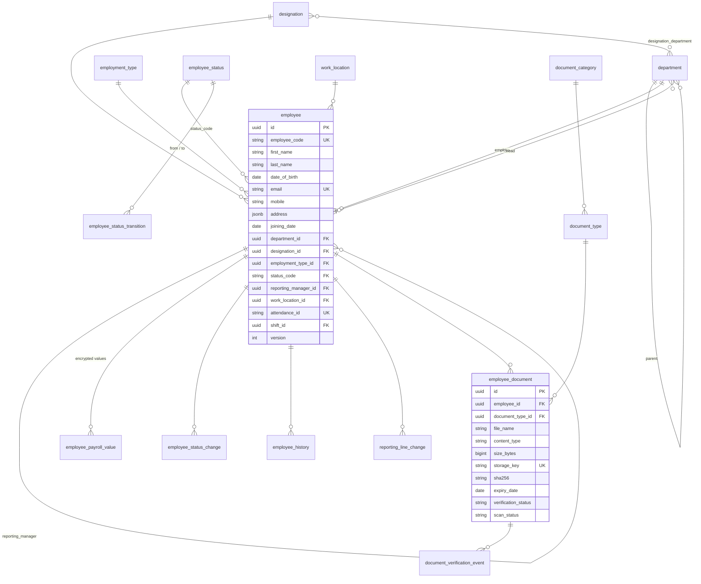

## Attendance

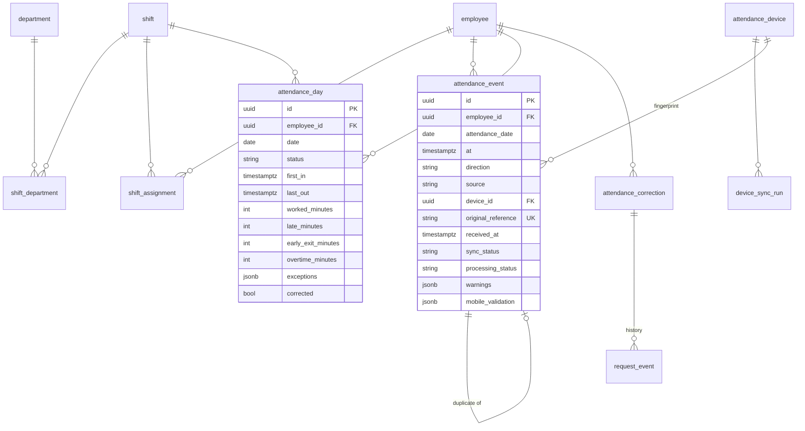

## Leave and requests

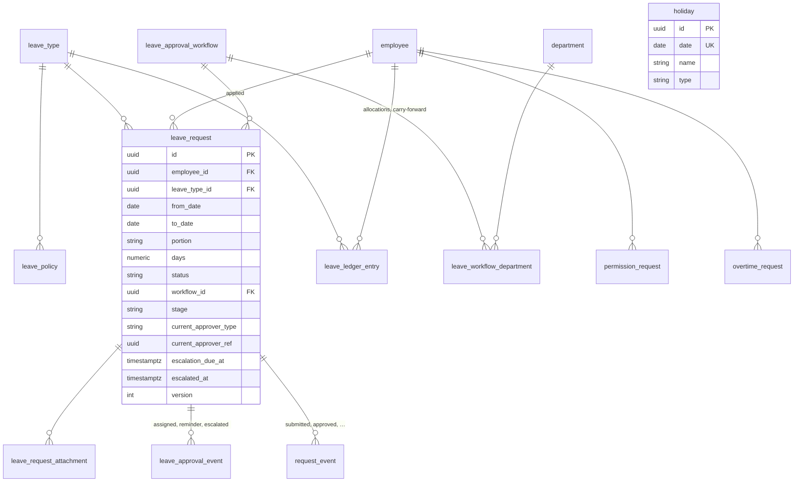

## Payroll

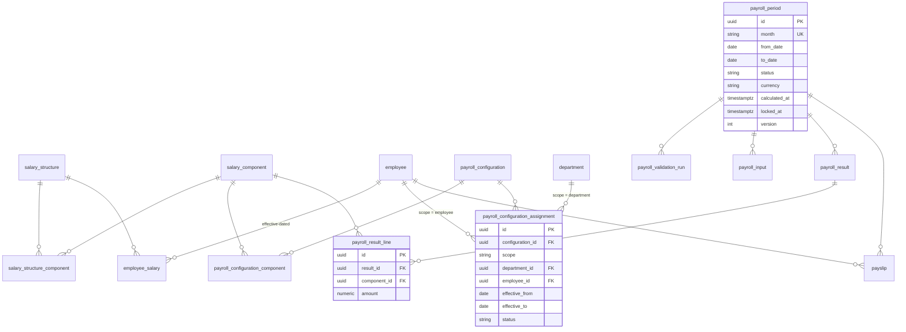

## Performance

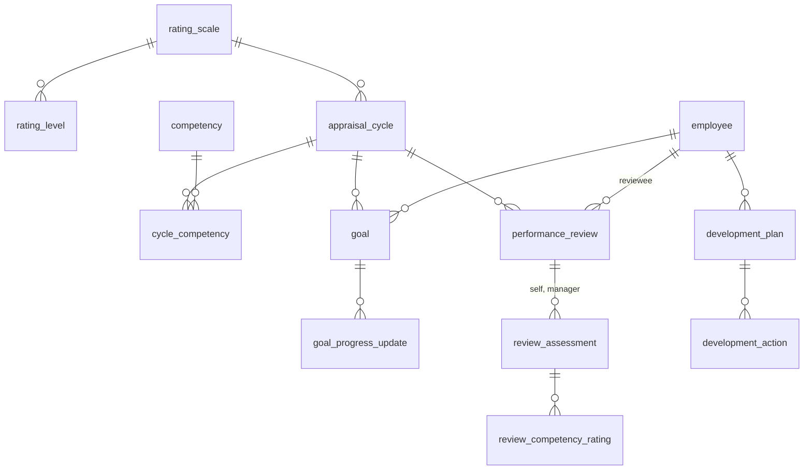

## HR administration and platform

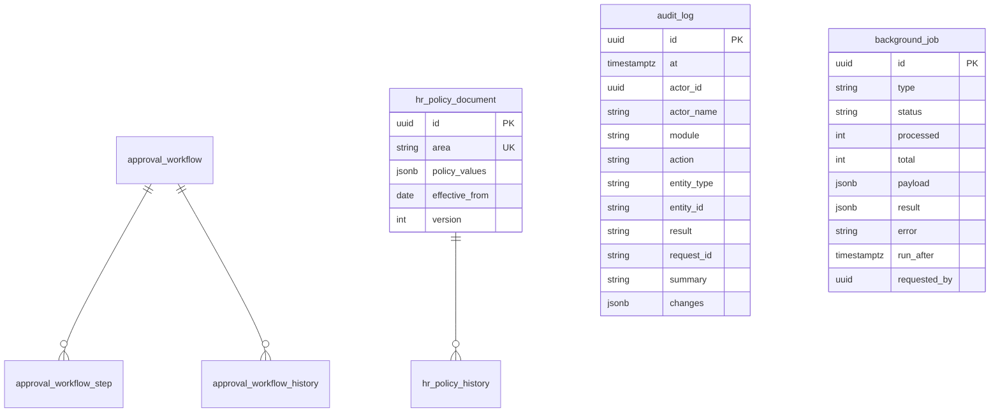

`audit_log` is insert-only: a trigger rejects UPDATE and DELETE, and the application's database
role has only INSERT and SELECT on it.

## Employees (migration 0004)

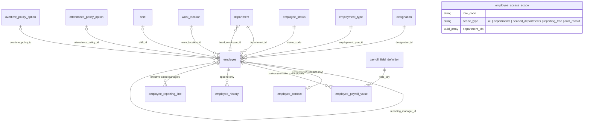

## Employee documents (migration 0005)

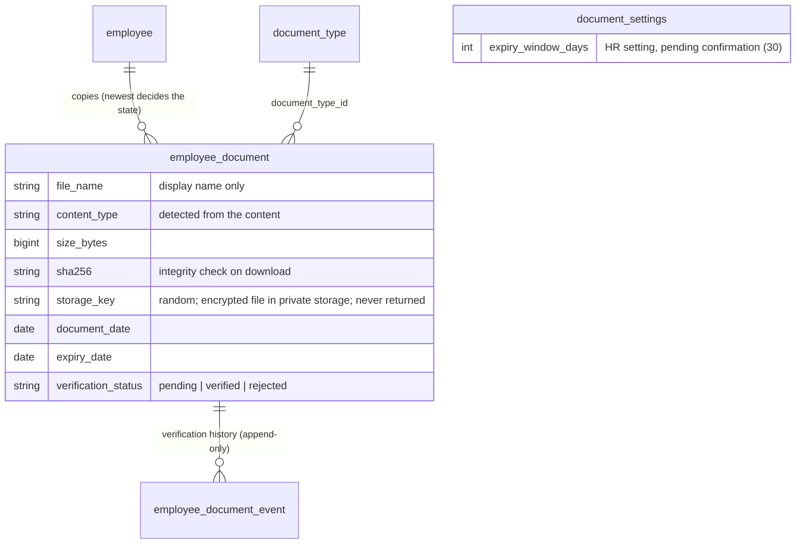

## Employee import jobs (migration 0006)

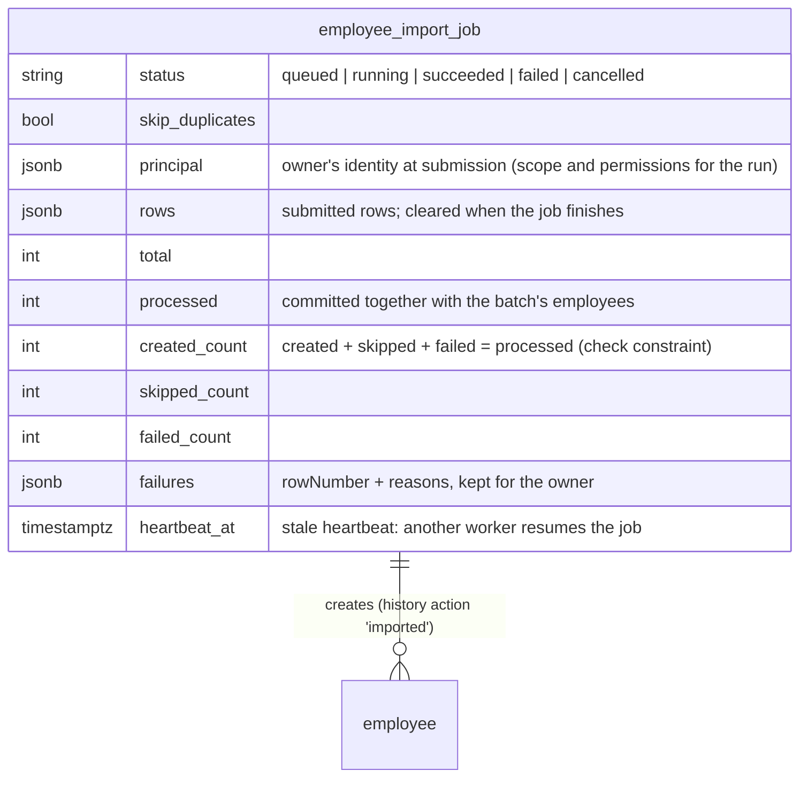

## Time & attendance (migration 0007)

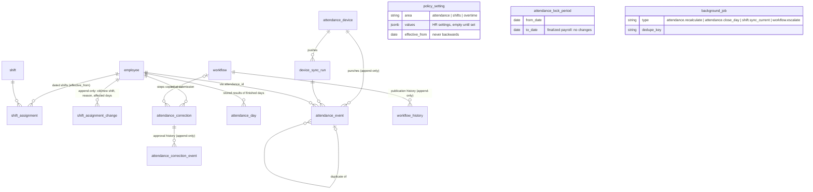

## Leave management (migration 0008)

Adds tables only; no Module 1–5 table changes. Append-only (database trigger): `leave_ledger_entry`,
`request_event`, `leave_routing_event`, `leave_workflow_history`. `leave_type.code` cannot change.

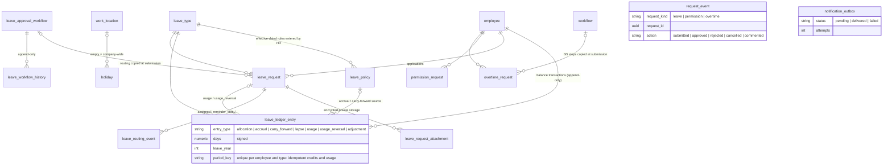
