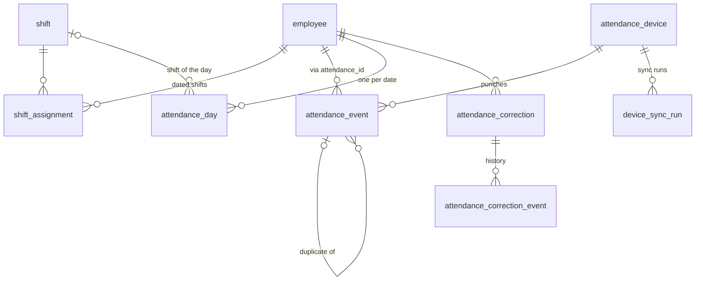

# Module 5 Analysis: Time & Attendance

**Status: approved and implemented (2026-11-03).** Final decisions: [`MODULE_5_DECISIONS.md`](MODULE_5_DECISIONS.md); completion report in `MODULE_REPORTS.md`.

**Sources:**
- frontend contract `HRMS_API_CONTRACTS.md`: E (general rules), E1 (attendance and shifts), E-Q (open questions), H1 (calendar), H2 (events and devices), G6 (HR policies), A4 (record scoping), A9 (files), A10 (jobs);
- frontend types: `src/features/hr/attendance/api/attendance.service.ts` (35 types) and `attendance.http.ts` (18 calls);
- the 7 attendance screens.

Every rule below cites its source or is listed as a question in section 5. No attendance policy value
is invented.

## 1. Name and business scope

**Module 5: Time & Attendance**, phase 4b of `ANALYSIS.md` section 11.

Turns punches from fingerprint devices (and, if approved, the mobile app) into one calculated
attendance record per employee per day, and gives HR the screens they need:

- **Shift assignments:** who works which shift, from which date. Shift *definitions* are already done in Module 1.
- **Attendance events:** receiving, validating, de-duplicating and storing raw punches, and showing them.
- **Attendance calculation:** day status, first in / last out, worked, late and overtime minutes, exceptions and warnings, computed by the backend only (contract E: "The browser never calculates").
- **Daily register, day detail, dashboard summary, monthly totals and the employee calendar**, plus the monthly export (CSV/XLSX).
- **Attendance corrections:** request, approve or reject. Approving replaces that day's punches.
- **Attendance devices:** a read-only status list and sync history.
- **HR attendance settings** (G6 policy areas `attendance`, `shifts`, `overtime`): the thresholds the calculation needs, entered by HR. Nothing is pre-filled.

**Out of scope (later modules):**
- leave and holidays (Module 6): `on_leave` and `holiday` days appear once those exist;
- payroll use of attendance (payroll module);
- approval *workflows* configuration (G5, HR administration module);
- the mobile app itself;
- device vendor connectors (pending R8, see 5.3);
- the `/hr/me/attendance` page (frontend phase 7, not built).

## 2. Frontend endpoints and screens

### 2.1 Endpoints (18 calls in `attendance.http.ts`; 3 already done in Module 1)

| # | Method | Path | Screen | Permission (contract) | Status |
|---|---|---|---|---|---|
| 1 | GET | `/hr/attendance/summary?date=` | Attendance Overview | `hr.attendance:view` | new |
| 2 | GET | `/hr/attendance/daily?date=&page=&pageSize=&sort=&q=&departmentId=&shiftId=&status=&exceptionsOnly=&source=&warningsOnly=` | Daily Register | `hr.attendance:view` | new |
| 3 | GET | `/hr/attendance/daily/{employeeId}?date=` | Day detail drawer | view, or own/team | new |
| 4 | GET | `/hr/attendance/monthly?month=&page=&pageSize=&sort=&q=&departmentId=` | Monthly Attendance | `hr.attendance:view` | new |
| 5 | GET | `/hr/attendance/monthly/{employeeId}?month=` | Monthly detail drawer | view, or own/team | new |
| 6 | GET | `/hr/attendance/monthly/export?month=&departmentId=&q=&employeeId=` | Monthly Attendance (download) | `hr.attendance:view` | new |
| 7 | GET | `/hr/attendance/employees/{employeeId}/calendar?month=` | Employee calendar (profile) | `hr.attendance:view` in scope, or own record | new |
| 8 | GET | `/hr/attendance/events?date=&…&source=&syncStatus=&exceptions=` | Attendance Events | `hr.attendance:view` | new |
| 9 | GET | `/hr/attendance/events/{eventId}` | Event drawer | `hr.attendance:view` | new |
| 10 | GET | `/hr/attendance/corrections?status=&departmentId=&q=&sort=` | Attendance Corrections | `hr.attendance-corrections:view` | new |
| 11 | GET | `/hr/attendance/corrections/{id}` | Correction drawer | as above | new |
| 12 | POST | `/hr/attendance/corrections` | Correction form | `…corrections:submit`, or own with `hr.self:submit-requests` | new |
| 13 | POST | `/hr/attendance/corrections/{id}/decision` | Correction drawer | `…corrections:approve`, or direct reports with `hr.approvals:act` | new |
| 14 | GET | `/hr/shifts` | Shift Management | `hr.shifts:view` | ✅ Module 1 (`assignedEmployees` from Module 2) |
| 15 | POST/PUT | `/hr/shifts[/{id}]` | Shift Management | `hr.shifts:manage` | ✅ Module 1 |
| 16 | POST | `/hr/shifts/{id}/assignments` | Shift assign dialog | `hr.shifts:assign` | new |
| 17 | GET | `/hr/attendance-devices` | Attendance Devices | `hr.devices:view` | new |
| 18 | GET | `/hr/attendance-devices/{id}/sync-history` | Device drawer | `hr.devices:view` | new |

### 2.2 Additions the frontend does not call

These are needed to feed and configure the module.

| Method | Path | Purpose |
|---|---|---|
| POST | `/hr/attendance/events/ingest` | Devices or a connector push punches. Authenticated per device with a hashed API key, not a user token. Proposed in `ANALYSIS.md` Q5. |
| GET/PUT | `/admin/policies/{area}` for `attendance`, `shifts`, `overtime` | Contract G6, HRMS-owned. HR enters the thresholds. Fields are defined by the backend; values start empty. |
| GET/POST/PUT | `/hr/setup/attendance-devices` | Register devices and issue or rotate their API keys (`hr.devices:manage`). |

### 2.3 Screens

The screens (`features/hr/attendance/pages`) are:
- `AttendanceDashboardPage`
- `DailyAttendancePage`
- `MonthlyAttendancePage`
- `AttendanceEventsPage`
- `CorrectionsPage`
- `ShiftsPage`
- `DevicesPage`

Plus the employee calendar on the profile.

## 3. Database entities and relationships

**New tables (migration 0007).** All have audit columns; editable ones are versioned.

| Table | Purpose | Key relationships and constraints |
|---|---|---|
| `shift_assignment` | Dated history of which shift an employee works ("the backend keeps dated history", E1) | FK `employee`, `shift`; unique (employee, effective_from). `employee.shift_id` mirrors the assignment in force today. |
| `attendance_device` | Registered devices: name, location (FK `work_location`), serial number, hashed API key, status fields | Unique serial number. The key is stored only as a hash. |
| `device_sync_run` | One row per device push: started/finished, `success \| partial \| failed`, events received, message | FK `attendance_device` |
| `attendance_event` | Raw punches, **append-only**: employee, `at`, direction, source, device, app reference, `received_at`, `attendance_date`, sync and processing status, `original_event_id`, original reference, warnings, mobile validation (JSONB) | FK `employee`, `attendance_device`; self-FK for duplicates; unique (device, original reference) so a device resend is idempotent |
| `attendance_day` | **The calculated record**, one per employee per date: status, shift, first in / last out with sources, worked / late / overtime / beyond-shift minutes, exceptions, warnings, `corrected`, `calculated_at`, policy versions used | Unique (employee, date); FK `employee`, `shift`. Derived and recalculable, never edited by hand. |
| `attendance_correction` | A correction request: employee, date, original and requested in/out, reason, status `pending → approved \| rejected \| cancelled`, decision comment, version | FK `employee`; one *pending* request per employee and date (partial unique index, E1 "duplicate pending request") |
| `attendance_correction_event` | Request history (`submitted \| approved \| rejected \| cancelled \| commented`), **append-only** | FK `attendance_correction` |
| `policy_setting` | G6 values per area, **effective-dated** (a change applies from `effectiveFrom`, never backwards) | Unique (area, effective_from); values JSONB checked against the backend's field definitions |
| `background_job` | Generic queue for the new job types: attendance recalculation, the nightly day close, large exports. Same mechanics as the Module 4 job (SKIP LOCKED, heartbeat, resume); `employee_import_job` stays unchanged. | — |

**Existing tables used** (no changes to Modules 1–4 tables are planned):
- `employee`: `attendance_id`, `shift_id`, `attendance_policy_id`, `overtime_policy_id`, joining date, status;
- `shift`: times, overnight, break, grace, working days;
- `attendance_policy_option`, `overtime_policy_option`, `work_location`, `department`, `employee_access_scope`, `audit_log`.

## 4. Dependencies on Modules 1–4

| Module | What Module 5 uses |
|---|---|
| 1. Organization and reference data | Shift definitions (start, end, overnight, break, grace, working days); departments for filters; work locations for devices; attendance and overtime policy *names* (options) |
| 2. Employees | Employee records (joining date: no days before it; `attendance_id` maps device punches to an employee; current `shift_id`); **organizational scopes** for every read and write; statuses marked `employmentEnded` (no further days calculated after an exit; pending HR); reporting lines (managers decide corrections for their direct reports, E); audit and history conventions |
| 3. Documents | None (correction attachments are not in the contract) |
| 4. Import | The background worker and job mechanics (claiming, heartbeat, resume) are reused for recalculation, the nightly day close and exports. Imported employees' attendance IDs feed event mapping. |
| Foundation | Authentication, permissions, CSRF, audit log, error envelope, paging, optimistic concurrency |
| **Not yet built** | Leave (`on_leave`, half-day leave) and holidays come in the leave module. Until then those statuses never appear, and the calendar's `approvedLeaveDays` and `holidays` counts are 0. The calculation has a hook for them, so no rework is needed. |

## 5. Business rules requiring HR, management or IT confirmation

**Approach:** values come only from HR configuration (G6 policies, shift settings). Where a needed value
is not set, the rule is **not applied**, and the day carries a warning ("Set the half-day threshold
in HR Policies → Attendance"), as `ANALYSIS.md` section 8 requires. No defaults are invented.

### 5.1 Calculation rules (the proposed order follows `ANALYSIS.md` section 8 and the frontend samples)

| # | Rule or value | Proposal | Source | Needs |
|---|---|---|---|---|
| A1 | Order of day statuses | on leave → holiday → weekly off → not started → absent → missing punch → half day → late → present | ANALYSIS §8 | HR |
| A2 | Weekly offs | Days not in the assigned shift's `workingDays` | Frontend shift model | HR |
| A3 | Worked minutes | Last out − first in. **Whether the shift break is deducted** is a policy switch, with no default | §8 states "− shift break"; not in the contract | HR |
| A4 | Lateness | First in later than shift start + grace. Grace comes from the shift; if the shift has none, from `defaultGraceMinutes` (policy) | E1, §8 | HR |
| A5 | Half day by worked time | Only when `halfDayBelowMinutes` is set. Not to be confused with approved half-day leave | H-Q1 | HR |
| A6 | Absent by worked time | Only when `absentBelowMinutes` is set | Frontend mock field | HR |
| A7 | Overtime | Minutes beyond shift length, only for employees whose overtime policy option is eligible, subject to `minimumMinutes`, `roundingMinutes` and `maxMinutesPerDay` (policy). Which options count as "eligible" is an HR setting. | §8 | HR |
| A8 | Missing punch on the current day | Not an exception before the shift ends (frontend expectation) | E-Q1 | HR |
| A9 | Overnight shifts | Punches belong to the shift's **start** date (frontend assumption) | E-Q2 | HR |
| A10 | Calendar summary definitions | `presentDays` = present + late + missing punch; half days counted separately; leave days + 0.5 per half day | H1, H-Q1 | HR |
| A11 | Different rules per named attendance policy (AP-STAFF vs AP-SHOP) or one company-wide set (G6 has one set per area) | Proposal: one company-wide set now; per-policy overrides later if HR needs them | Module 1 options vs G6 | HR |
| A12 | Employees whose employment ended | No days calculated after the effective exit date | Module 2 setting | HR |

### 5.2 Corrections

| # | Rule | Proposal | Source | Needs |
|---|---|---|---|---|
| C1 | How far back a correction may be requested | `correctionWindowDays` (policy). Not applied until set. | §8 | HR |
| C2 | Who decides | HR with `…corrections:approve` for anyone; managers with `hr.approvals:act` for direct reports only; **never one's own request** | Contract E | Confirm |
| C3 | Rejecting needs a comment; a stale version returns 409; deciding a non-pending request returns 409 | — | Contract E | — |
| C4 | Whether approval routes through configurable workflows (G5 `attendance_correction`) | Direct rule C2 now; workflows in the HR administration module | G5 | Management |
| C5 | Whether a correction on a locked payroll period is allowed | Refused once payroll exists (409 `PERIOD_LOCKED`) | E4 | HR + Finance |

### 5.3 Devices and events

| # | Item | Proposal | Needs |
|---|---|---|---|
| D1 | Device vendor and model; push or pull (R8, D7) | A generic ingest API with per-device keys; vendor connector later | IT |
| D2 | Mobile app attendance in scope? Location and geofence data approved? (D8) | Not in Module 5. `mobile_app` events are refused until decided; `mobileValidation` is reported only for checks actually made | Management + IT + Legal |
| D3 | Duplicate window (same employee, direction and device) | A setting with **no default**; until set, only exact repeats (same device reference) are duplicates | IT + HR |
| D4 | "Delayed sync" threshold | A setting with **no default**; until set, nothing is flagged as delayed. This corrects the "1 hour" in ANALYSIS §8, which is not in the contract. | IT + HR |
| D5 | Device clock and time zone | Devices send ISO timestamps with an offset; days are assigned in the company time zone (`COMPANY_TIME_ZONE`, item 30) | IT |
| D6 | Unknown attendance ID on a punch | Stored as `rejected` with the exception "Unknown attendance ID", visible on the Events screen, never counted | Confirm |

### 5.4 Other

| # | Item | Proposal | Needs |
|---|---|---|---|
| O1 | Shift assignment effective dates: back-dated assignments allowed? Limit? | Future or today only, until HR decides. Back-dated changes would recalculate past days and may affect payroll. | HR |
| O2 | Summary: "up to 8 exceptions, most serious first". The ranking of exceptions. | missing punch → absent → late → warnings | Contract E1 + HR |
| O3 | Retention of raw events | Keep everything (no deletion) until a policy exists | HR + Legal |

## 6. Proposed implementation sequence (one module, with a checkpoint after each step)

1. **5.1 Configuration:** `policy_setting` with G6 `attendance`, `shifts` and `overtime` (fields defined, values empty), and shift assignments (POST `…/assignments`, dated history, `employee.shift_id` kept in step).
2. **5.2 Devices and ingestion:** device registry with hashed keys, `POST …/events/ingest`, validation, idempotency, duplicate detection, sync runs, plus `GET` devices, sync history, events and event detail.
3. **5.3 Calculation:** the attendance-day calculator (pure functions, tested on their own), recalculation jobs (`background_job`) triggered by events, corrections, assignments and policy changes, and the nightly close for past days.
4. **5.4 Read screens:** summary, daily register, day detail, monthly, monthly detail, calendar, and export (CSV/XLSX, safe from formula injection).
5. **5.5 Corrections:** submit, list, detail, decision (replaces punches, recalculates the day), and history.
6. **5.6 Wrap-up:** contract check, docs (decisions, pending list, API mapping, ER diagram), completion report, `hrms-service-module5.zip`.

**Estimated size:** about 15 endpoints, 9 tables and 3 job types. This is the largest module so far, so after
each step I will run the full test suite and migration checks before continuing.

## 7. Test plan

| Area | Tests |
|---|---|
| Calculator (unit) | Each day status in priority order; overnight shifts across midnight; grace from shift versus policy; break switch on and off; half-day and absent thresholds set and unset (unset: rule not applied, warning shown); overtime eligibility, minimum, rounding and cap; missing punch today before and after shift end; days before joining and after exit; weekly offs from working days |
| Ingestion | Valid key; wrong or revoked key (401); unknown attendance ID (rejected and visible); device resend (idempotent); duplicate within the window, and window unset; delayed flag; out-of-order arrival; timestamps with offsets; malformed payloads (422); rate and size limits; audit of sync runs |
| Recalculation | Event → day recalculated by the worker; correction approval → recalculated; assignment change → affected dates recalculated; a policy change applies only from its effective date; resume after a worker stop |
| Read endpoints | Contract shapes field by field (`tools/verify_contracts.py`); filters, sorts (unknown → 400) and paging; summary counts against hand-checked data; calendar: no future dates, none before joining, future month → 422; export CSV and XLSX contents and formula neutralisation |
| Corrections | Future date, out ≤ in and duplicate pending → 422; outside the correction window (when set); reject without comment → 422; stale version → 409; deciding a non-pending request → 409; deciding one's own request → 403; manager decides direct reports only; approval replaces punches and marks the day `corrected`; history |
| Authorization and scope | Every endpoint without permission → 403 (audited); employees outside organizational scope → 404/403 as the contract says; own-record access with `hr.self:*`; device keys cannot call user endpoints and user tokens cannot ingest |
| Large data | One month for 1,000 employees (about 30,000 day records): monthly register and export within an agreed time; ingesting 10,000 events in batches |
| Migrations | 0007 on a fresh database, downgrade and upgrade, `alembic check`; Modules 1–4 migrations unchanged (fingerprints); full suite green |

## 8. Decisions needed before starting

Approval of this scope and sequence, plus answers to (or "use the proposals" for) A1–A12, C1–C5,
D1–D6 and O1–O3. The values themselves (thresholds, windows) do **not** block implementation: they are
HR settings that start empty, and rules stay off until HR sets them. The decisions that **do** change the
build are:

- **A11:** one company-wide rule set, or rules per named attendance policy.
- **D2:** whether mobile app attendance is in scope.
- **C4:** whether correction approval must go through configurable workflows now.
- **O1:** whether back-dated shift assignments are allowed.
